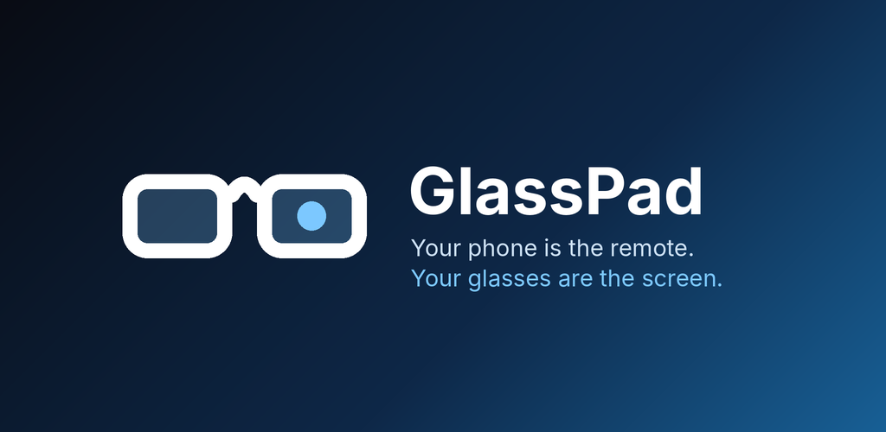
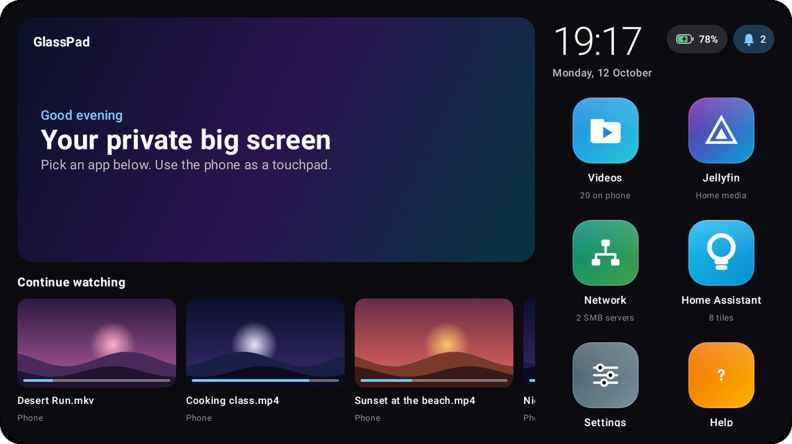
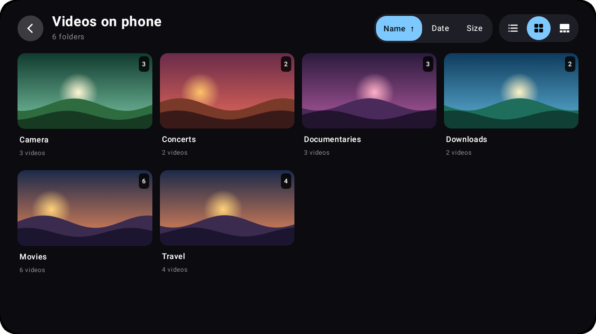
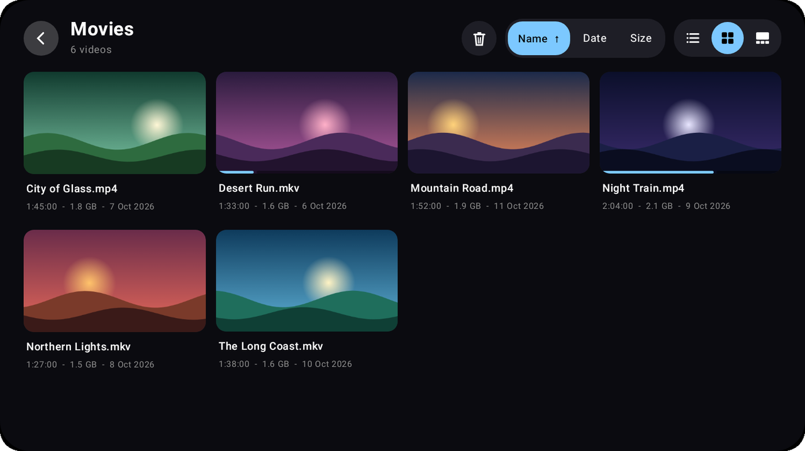
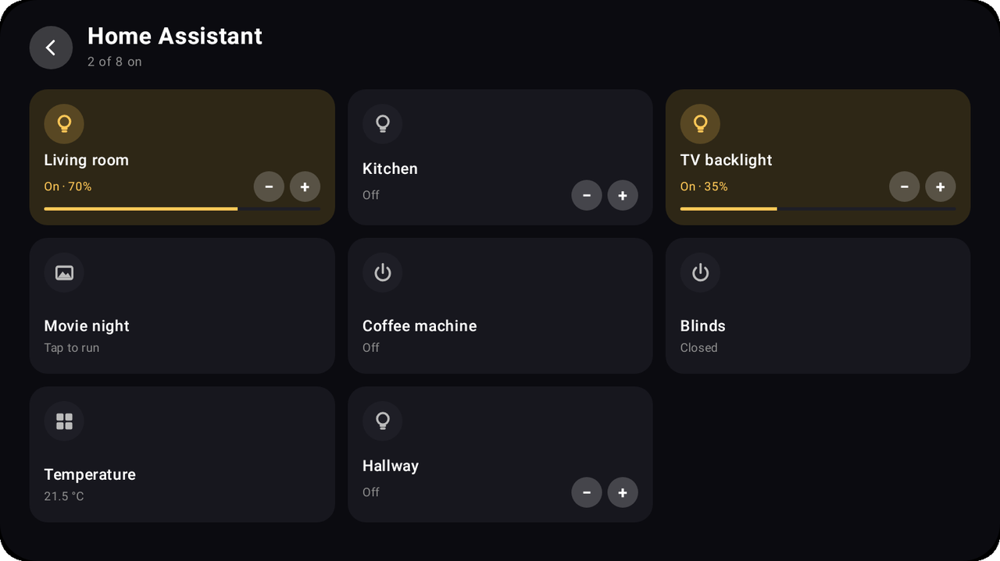
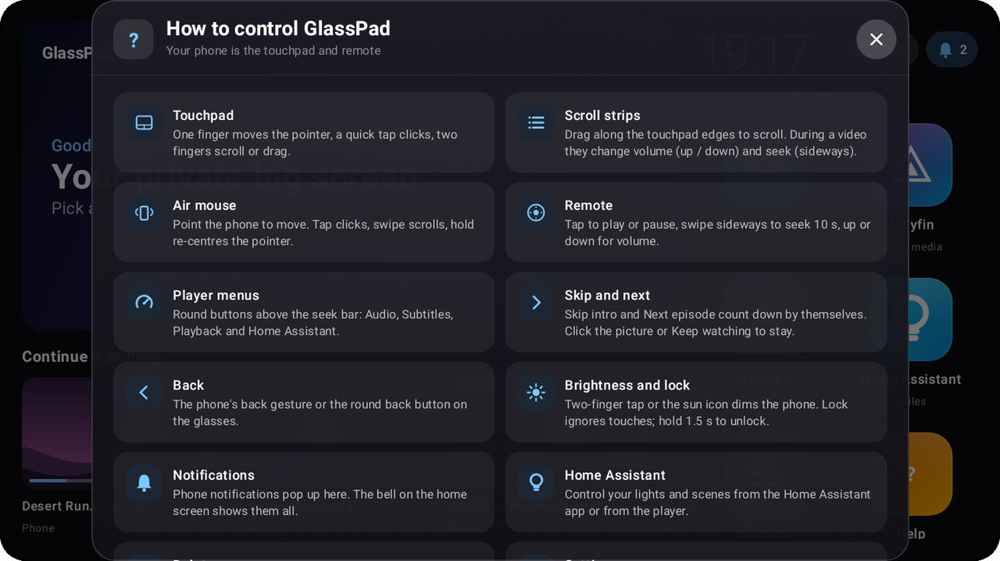

<p align="center">
  
</p>

# GlassPad (beta)

**Your phone is the remote. Your glasses are the screen.**

GlassPad is a free Android app for **VITURE Beast** XR glasses. Plug the glasses into your phone and GlassPad opens a big-screen home on them, with your own videos, network shares, Jellyfin library and Home Assistant in one place. Your phone becomes the controller: use it as a touchpad, an air mouse or a simple remote, and let its screen go dark while the video keeps playing on the glasses.

No accounts, no ads, no tracking. By default it only talks to servers on your home network.

> **Beta.** This is an early build for people who like trying new things. Expect rough edges, and please report them. See [Feedback](#feedback).

**[⬇ Download the latest APK](../../releases/latest)**

---

## Screenshots

<p align="center">
  <br>
  <sub>Home screen: continue watching, apps, clock, battery and notifications</sub>
</p>

<table>
  <tr>
    <td width="50%"><br><sub>Your phone's videos, by folder</sub></td>
    <td width="50%"><br><sub>Inside a folder, with watch progress</sub></td>
  </tr>
  <tr>
    <td width="50%"><br><sub>Home Assistant: lights, scenes and switches</sub></td>
    <td width="50%"><br><sub>Built-in help for the phone gestures</sub></td>
  </tr>
</table>

<sub>Screenshots show demo content, as seen on the glasses.</sub>

## Features

### Control from your phone
- **Touchpad:** move the pointer with one finger, like a laptop. Two fingers scroll.
- **Air mouse:** point the phone at what you want, using its motion sensor.
- **Remote:** big, simple taps and swipes for play, seek and volume.
- **Edge strips (optional):** slide along the edges of the phone screen to scroll, change the volume or seek. Width is adjustable.
- **Dim and lock:** the phone screen goes dark while you watch, and can be locked against accidental touches.

### Home screen on the glasses
- Hero banner with what you're watching and what's next in Jellyfin.
- **Continue watching** across phone, network and Jellyfin videos. You choose which sources show up.
- Clock, phone battery (with charging state) and notifications at a glance.

### Your videos, wherever they are
- **On the phone:** browse videos by folder, with thumbnails.
- **Network shares:** SMB shares from a NAS or computer. Add as many servers as you like.
- **Jellyfin:** movies, series and seasons, with posters, ratings, genres and watched status. Progress syncs back to your server.

### Player
- Subtitles (several styles), audio track selection and playback speed.
- Skip intro, **Up next** with auto-play, previous / next and 10-second skips.
- Video fit and size options, so the picture sits comfortably in your view.
- Playback controls in the phone's notification and lock screen.

### Smart home
- **Home Assistant tiles** for lights, switches and scenes, on their own screen and in a menu inside the player, so you can dim the lights without stopping the movie.
- Several Home Assistant servers supported, for example home and a holiday place.

### Phone notifications (optional)
- See your phone's notifications on the glasses while you watch, and send quick replies.

### Setup and settings
- A short welcome flow on first launch.
- **Full screen** or **Desktop window** display modes, with adjustable size.
- Backup and restore of all settings to one file, with an optional password to include saved passwords and tokens.
- A diagnostics report you can share when something goes wrong.

## Requirements

- Android 10 or newer.
- A phone that sends video over USB-C (DisplayPort Alt Mode). Most recent Pixels and Samsung Galaxy S phones do. Many budget phones don't.
- VITURE glasses. Other USB-C display glasses that act as a plain external screen should work too, but are untested.

## Install

1. On your phone, open the **[latest release](../../releases/latest)** and download `GlassPad-…-beta.apk`.
2. Open the file. If Android asks, allow your browser or file manager to **install unknown apps**.
3. Open GlassPad, follow the short welcome steps, then plug in the glasses.

**Updating:** install the new APK over the old one. Your settings are kept.

**Get notified of updates:** add this repository to [Obtainium](https://github.com/ImranR98/Obtainium) (paste the URL of this page). It will tell you when a new version is out.

### Verify the download (optional)

Each release has a `.sha256` file with the APK's checksum. All builds are signed with the same key:

```
SHA-256 signing certificate:
16:4B:A8:28:EF:E8:32:6F:6F:A9:80:0C:52:15:94:C0:41:C5:BE:95:D4:04:05:5C:2A:00:E2:E4:A3:F5:94:19
```

You can check it with `apksigner verify --print-certs GlassPad-…-beta.apk`, or with apps like *App Manager*.

## Permissions, and why

| Permission | Why |
|---|---|
| Videos | List and play the videos on your phone. Optional: without it you can still pick single videos with Android's picker. |
| Network | Reach the servers you add (Jellyfin, SMB, Home Assistant). |
| Notifications | The "Playing on glasses" notification with playback controls. |
| Notification access *(optional, off until you turn it on)* | Show your phone's notifications on the glasses and send replies. |
| Foreground service, wake lock | Keep the video playing while the phone screen is dimmed. |

## Privacy

- No accounts, ads, analytics or tracking. GlassPad does not contact any server run by the developer, and has no idea how many people use it.
- By default it only connects to servers on your **home network or VPN** (for example 192.168.x.x, `.local` names, Tailscale). Internet servers have to be allowed in Settings › Privacy & network.
- Passwords and tokens are encrypted on the phone.

Full policy: [PRIVACY.md](PRIVACY.md)

## Feedback

- **Found a bug?** [Open an issue](../../issues/new/choose). In GlassPad, Settings › About › **Share diagnostics** creates a short report (no passwords or tokens) you can paste in.
- **Have an idea?** Open a feature request the same way.

What's new in each version: [CHANGELOG.md](CHANGELOG.md)

---

GlassPad is an independent app. It is not made by, affiliated with or endorsed by VITURE. VITURE is a trademark of its owner.

The app is free to use and is provided as is, without warranty.
